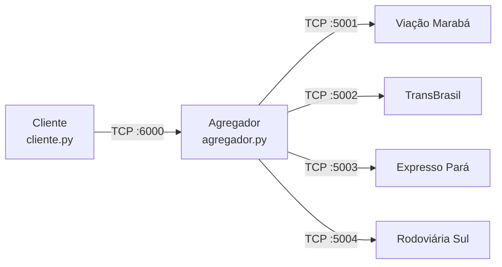
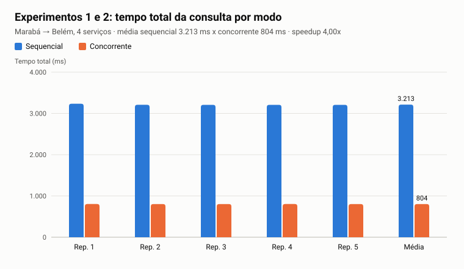
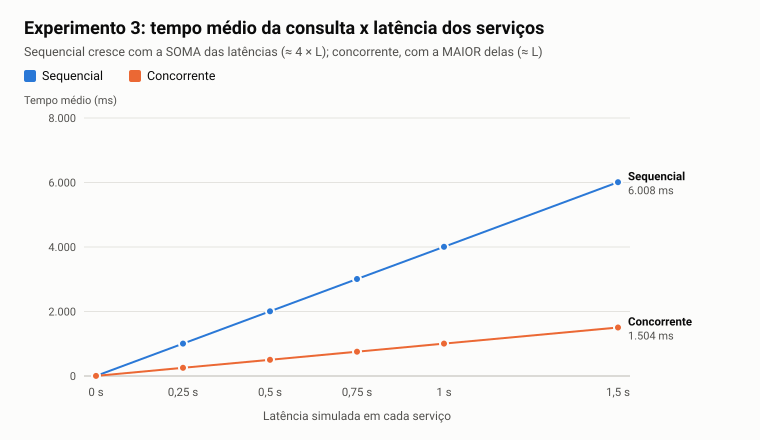
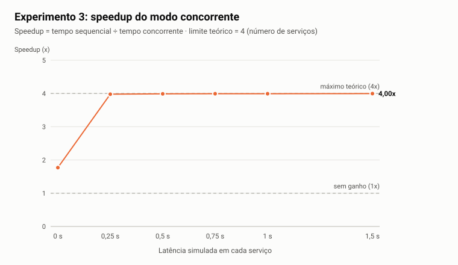
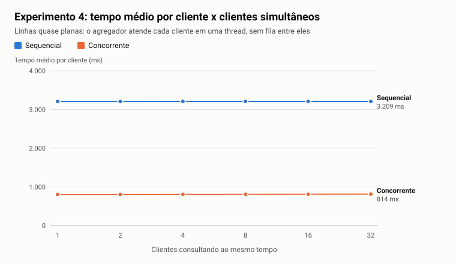
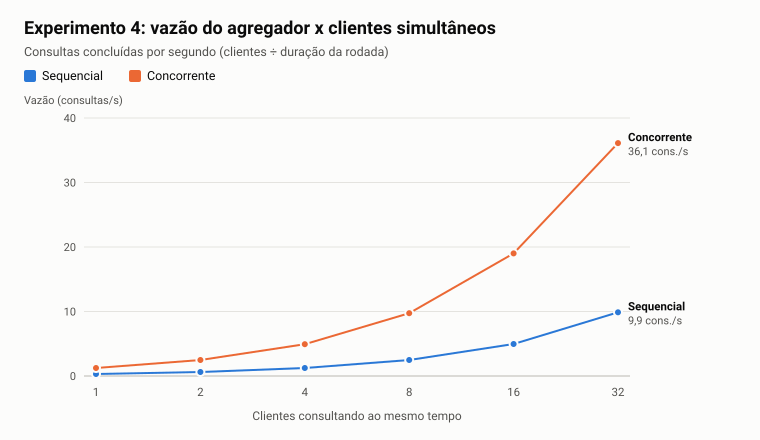
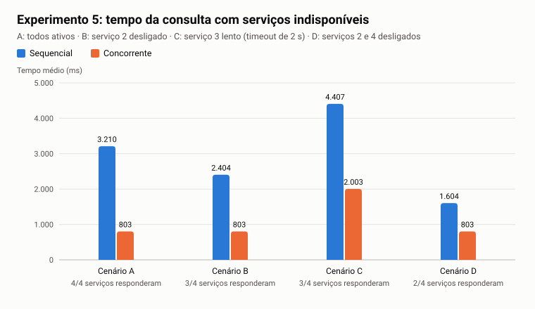

# Comparador de Passagens Rodoviárias

> Trabalho 1 de **Sistemas Distribuídos**: agregador concorrente com sockets TCP e multithreading em Python puro.

**Universidade Federal do Sul e Sudeste do Pará (UNIFESSPA)**, Faculdade de Sistemas de Informação (FACSI)
**Professor:** Gleison de Oliveira Medeiros. **Tema 2:** Comparador de Passagens Rodoviárias.

**Grupo II:** André · João Marcos · João Lucas · Vitor Emanuel · Gustavo Carvalho

---

## Sumário

- [Visão geral](#visão-geral)
- [Estrutura do projeto](#estrutura-do-projeto)
- [Requisitos para rodar](#requisitos-para-rodar)
- [Como rodar](#como-rodar)
- [Exemplo de uso](#exemplo-de-uso)
- [Experimentos](#experimentos)
- [Documentação](#documentação)
- [Trabalhando em grupo com Git](#trabalhando-em-grupo-com-git)
- [Problemas comuns](#problemas-comuns)

---

## Visão geral

O passageiro informa **origem, destino e data**. O sistema consulta **4 empresas de ônibus independentes**, junta as viagens, ordena por preço e destaca a **mais econômica**.

São **6 processos independentes** que se comunicam apenas por **sockets TCP reais**, trocando mensagens **JSON**:



O agregador consulta as empresas em dois modos:

- **Sequencial:** uma empresa por vez. O tempo total é a **soma** dos tempos das empresas.
- **Concorrente:** uma **thread por empresa**, todas disparadas juntas e sincronizadas com `join()`. O tempo total é o da empresa **mais lenta**.

Outras características:

- **Tolerância a falhas:** cada serviço tem timeout de 2 s. Um serviço desligado ou lento é ignorado e vira um aviso, sem travar a consulta.
- **Múltiplos clientes:** o agregador atende cada cliente em uma thread separada.
- **Somente Python puro:** usa apenas `socket`, `threading`, `json`, `time`, `sys` e `csv`. Não há nada para instalar com `pip`.

## Estrutura do projeto

```
comparador-passagens/
├── servicos/                          # 4 empresas (processos independentes)
│   ├── servico_1_viacao_maraba.py     #   porta 5001
│   ├── servico_2_transbrasil.py       #   porta 5002
│   ├── servico_3_expresso_para.py     #   porta 5003
│   └── servico_4_rodoviaria_sul.py    #   porta 5004
├── agregador/
│   └── agregador.py                   # porta 6000: sequencial e concorrente
├── cliente/
│   └── cliente.py                     # interface de terminal
├── experimentos/
│   ├── experimento.py                 # experimentos 1 a 5 automatizados
│   ├── gerar_graficos.py              # gera os gráficos SVG e o RESULTADOS.md
│   ├── RESULTADOS.md                  # tabelas e gráficos (gerado)
│   ├── graficos/                      # gráficos SVG (gerados)
│   └── resultados*.csv                # dados brutos (gerados)
├── docs/
│   ├── documento_de_requisitos.md     # requisitos, atores, casos de uso, RF/RNF
│   └── arquitetura.md                 # arquitetura, diagramas e protocolo
├── start.bat                          # sobe tudo no Windows
├── start.sh                           # sobe tudo no Linux/macOS
└── README.md
```

| Processo                   | Arquivo                                 | Porta |
|----------------------------|-----------------------------------------|-------|
| Serviço 1 - Viação Marabá  | `servicos/servico_1_viacao_maraba.py`   | 5001  |
| Serviço 2 - TransBrasil    | `servicos/servico_2_transbrasil.py`     | 5002  |
| Serviço 3 - Expresso Pará  | `servicos/servico_3_expresso_para.py`   | 5003  |
| Serviço 4 - Rodoviária Sul | `servicos/servico_4_rodoviaria_sul.py`  | 5004  |
| Agregador                  | `agregador/agregador.py`                | 6000  |
| Cliente                    | `cliente/cliente.py`                    | conecta na 6000 |

## Requisitos para rodar

- **Python 3.7 ou superior** (testado com Python 3.14). No Windows, marque **"Add Python to PATH"** ao instalar.
- Windows, Linux ou macOS. Nenhuma biblioteca externa é necessária.

## Como rodar

**Ordem: serviços, depois agregador, depois cliente.** Se algum serviço estiver fora do ar, o agregador continua funcionando e apenas avisa que ele está indisponível.

### Opção A: script automático

**Windows:** dê dois cliques em `start.bat`. Depois, no Prompt de Comando, dentro da pasta do projeto:
```bat
python cliente\cliente.py
```

**Linux/macOS:**
```bash
chmod +x start.sh      # só na primeira vez
./start.sh
python3 cliente/cliente.py
```

Os scripts abrem **5 janelas de terminal**: os 4 serviços e o agregador.

> No Linux sem terminal gráfico, o `start.sh` sobe os processos em segundo plano e grava os logs em `logs/`.

### Opção B: manual, um terminal por processo

Abra 6 terminais na pasta do projeto:

```bash
python servicos/servico_1_viacao_maraba.py     # terminal 1
python servicos/servico_2_transbrasil.py       # terminal 2
python servicos/servico_3_expresso_para.py     # terminal 3
python servicos/servico_4_rodoviaria_sul.py    # terminal 4
python agregador/agregador.py                  # terminal 5
python cliente/cliente.py                      # terminal 6 (abra quantos clientes quiser)
```

> No Linux, use `python3` se o comando `python` não existir. Para encerrar qualquer processo, use **Ctrl+C**.

### Latência simulada

Cada serviço tem no topo do arquivo `LATENCIA_SEGUNDOS = 0.8`. Também dá para passar a latência na linha de comando:
```bash
python servicos/servico_1_viacao_maraba.py 0      # sem latência
python servicos/servico_3_expresso_para.py 5      # serviço "lento": passa do timeout de 2 s
```

## Exemplo de uso

```
==============================================================================
        COMPARADOR DE PASSAGENS RODOVIÁRIAS - Sistemas Distribuídos
==============================================================================

  [1] Nova consulta
  [0] Sair
  Escolha uma opção: 1

------------------------------------------------------------------------------
  NOVA CONSULTA  (pressione Enter para usar o valor entre colchetes)
------------------------------------------------------------------------------
  Origem [Marabá]: Marabá
  Destino [Belém]: Belém
  Data (AAAA-MM-DD) [2026-11-20]: 2026-11-20
  Modo (1 = sequencial, 2 = concorrente) [2]: 2

  Consultando o agregador em 127.0.0.1:6000 (modo concorrente)...

==============================================================================
  Marabá -> Belém  |  Data: 2026-11-20
==============================================================================
EMPRESA         | SAÍDA | CHEGADA     | DURAÇÃO |        PREÇO
------------------------------------------------------------------------------
Rodoviária Sul  | 07:30 | 16:30       | 9h00    |    R$ 165,00  <-- MAIS ECONÔMICA
Viação Marabá   | 19:00 | 03:50 (+1)  | 8h50    |    R$ 168,50
Expresso Pará   | 20:00 | 04:45 (+1)  | 8h45    |    R$ 172,00
Viação Marabá   | 07:00 | 15:30       | 8h30    |    R$ 179,90
Rodoviária Sul  | 14:00 | 22:35       | 8h35    |    R$ 182,75
Viação Marabá   | 08:00 | 16:25       | 8h25    |    R$ 189,90
Expresso Pará   | 08:00 | 16:30       | 8h30    |    R$ 189,90
TransBrasil     | 13:00 | 21:30       | 8h30    |    R$ 198,40
Rodoviária Sul  | 22:00 | 06:55 (+1)  | 8h55    |    R$ 199,00
TransBrasil     | 06:30 | 14:50       | 8h20    |    R$ 215,00
TransBrasil     | 21:30 | 06:10 (+1)  | 8h40    |    R$ 229,90
------------------------------------------------------------------------------
  11 viagem(ns) encontrada(s), ordenadas por preço crescente.

  Tempo total: 813 ms | Modo: concorrente | Serviços que responderam: 4/4
  (tempo de ida e volta medido no cliente: 818 ms)
==============================================================================
```

`(+1)` indica chegada no dia seguinte. No modo **sequencial**, a mesma consulta leva cerca de **3.208 ms**.

**Rotas cadastradas:** Marabá → Belém, Marabá → Parauapebas e Belém → Marabá. Para outras rotas, cada empresa gera viagens genéricas. Acentos e maiúsculas são ignorados (`maraba` = `Marabá`).

### Demonstrando falhas na apresentação

1. Com tudo rodando, feche (Ctrl+C) a janela do **Serviço 2** e faça uma consulta:
   ```
   AVISO: Serviço 2 (TransBrasil) indisponível: conexão recusada (serviço desligado)
   Tempo total: 804 ms | Modo: concorrente | Serviços que responderam: 3/4
   ```
2. Suba um serviço **lento** com `python servicos/servico_3_expresso_para.py 5`. O agregador desiste dele após 2 s:
   ```
   AVISO: Serviço 3 (Expresso Pará) indisponível: tempo limite de 2 s excedido
   ```
3. Abra **dois ou mais clientes** e consulte ao mesmo tempo. Todos recebem a resposta sem esperar uns pelos outros.

## Experimentos

Com os 4 serviços e o agregador rodando:

```bash
python experimentos/experimento.py --experimento todos    # experimentos 1 a 5 (~6 min)
python experimentos/gerar_graficos.py                     # gráficos SVG + RESULTADOS.md
```

| Experimento (enunciado) | Comando | O que mede | Saída |
|---|---|---|---|
| 1 e 2: Sequencial x concorrente | `python experimentos/experimento.py --latencia 0.8` | 5 consultas em cada modo | `resultados.csv` |
| 3: Simulação de latência | `... --experimento 3` | latências de 0 a 1,5 s | `resultados_latencia.csv` |
| 4: Múltiplos clientes | `... --experimento 4` | 1 a 32 clientes ao mesmo tempo | `resultados_multiplos_clientes.csv` |
| 5: Indisponibilidade | `... --experimento 5` | serviço desligado, serviço lento, 2 desligados | `resultados_indisponibilidade.csv` |

Opções: `--repeticoes N` (padrão 5), `--latencia X` (padrão 0,8 s nos experimentos 4 e 5) e `--saida arquivo.csv` (experimentos 1 e 2).

O script ajusta a latência dos serviços pela própria rede, com as operações de controle `configurar_latencia`, `status` e `simular_queda` (veja [`docs/arquitetura.md`](docs/arquitetura.md)). No experimento 5, um serviço "desligado" **fecha a porta TCP de verdade** e volta sozinho ao fim do cenário. Ao terminar, a latência original de cada serviço é restaurada.

### Resultados

As tabelas completas estão em **[`experimentos/RESULTADOS.md`](experimentos/RESULTADOS.md)**.

Resumo (Linux, Python 3.14, tudo em localhost, latência de 0,8 s por serviço, 5 repetições):

| Experimento | Sequencial | Concorrente | Observação |
|---|---:|---:|---|
| 1 e 2: consulta padrão | 3.213 ms | 804 ms | **speedup de 4,00x** (75% mais rápido) |
| 3: latência 0 s → 1,5 s | 4,5 → 6.008 ms | 2,5 → 1.504 ms | sequencial ≈ 4 × L; concorrente ≈ L |
| 4: 1 → 32 clientes simultâneos | 3.208 → 3.209 ms | 803 → 814 ms | tempo por cliente quase constante, 0 falhas |
| 5B: serviço 2 desligado | 2.405 ms | 803 ms | 3/4 responderam, com aviso de indisponibilidade |
| 5C: serviço 3 lento (3 s) | 4.407 ms | 2.003 ms | o timeout de 2 s limita a espera |
| 5D: serviços 2 e 4 desligados | 1.604 ms | 803 ms | 2/4 responderam, o sistema continua funcionando |

| | |
|---|---|
|  |  |
|  |  |
|  |  |

> Os gráficos são SVG. Eles abrem no navegador e no GitHub, e podem ser inseridos no Word, no Google Docs ou no LibreOffice (Inserir → Imagem).

## Documentação

- [`docs/documento_de_requisitos.md`](docs/documento_de_requisitos.md): problema, objetivo, escopo, atores, casos de uso, RF01–RF10, RNF01–RNF06, restrições e critérios de aceitação.
- [`docs/arquitetura.md`](docs/arquitetura.md): arquitetura, diagramas (componentes e sequência), protocolo JSON completo, tratamento de erros e decisões de projeto.
- [`experimentos/RESULTADOS.md`](experimentos/RESULTADOS.md): tabelas e gráficos dos experimentos.

## Trabalhando em grupo com Git

```bash
# primeira vez
git clone <URL-do-repositório>
cd comparador-passagens

# antes de começar a mexer
git pull

# depois de alterar
git add .
git commit -m "Descreve o que mudou"
git push
```

Dicas:
- Combine quem mexe em qual arquivo para evitar conflitos. Os 4 serviços têm a mesma lógica, então uma mudança em um deve ser repetida nos outros.
- Depois de rodar os experimentos de novo, rode também o `gerar_graficos.py` e faça commit dos CSVs, dos SVGs e do `RESULTADOS.md` juntos.

## Problemas comuns

| Sintoma | Causa / solução |
|---------|-----------------|
| `ERRO: não foi possível usar a porta 500X` | O processo já está aberto em outra janela. Feche-o ou aguarde alguns segundos. |
| Cliente diz "não foi possível conectar ao agregador" | Suba o agregador antes do cliente. |
| Todos os serviços aparecem como indisponíveis | Os serviços não foram iniciados, ou o firewall bloqueou as portas 5001 a 5004. |
| `experimento.py` diz que processos não estão rodando | Suba os 4 serviços e o agregador primeiro. Se você atualizou o código, reinicie-os. |
| `python` não é reconhecido (Windows) | Reinstale o Python marcando "Add Python to PATH", ou use `py` no lugar de `python`. |
| Acentos aparecem errados no Windows | Use o Windows Terminal, ou rode `chcp 65001` antes. O `start.bat` já faz isso. |
