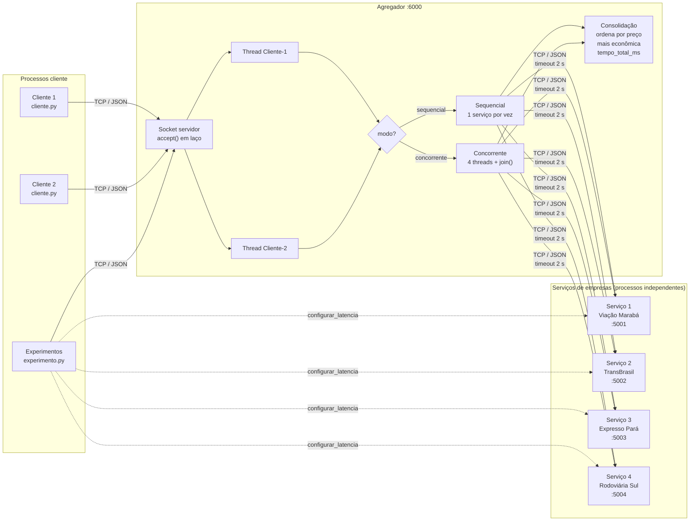
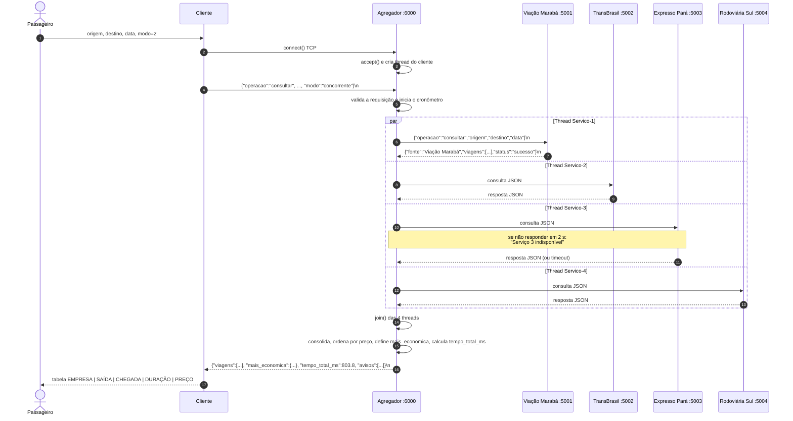

# Arquitetura: Comparador de Passagens Rodoviárias

## 1. Visão geral

O sistema segue o padrão **Cliente → Agregador → Serviços**, também chamado de *scatter-gather*: o agregador espalha a mesma consulta para vários serviços independentes e depois reúne as respostas.

São **6 tipos de processo**, cada um rodando em seu próprio terminal e conversando **apenas por sockets TCP**:

| Componente | Papel | Porta | Concorrência interna |
|------------|-------|-------|----------------------|
| Cliente (`cliente.py`) | Interface de terminal do passageiro | (cliente TCP) | Nenhuma: uma consulta por vez |
| Agregador (`agregador.py`) | Servidor para os clientes e cliente dos serviços | 6000 | 1 thread por cliente; no modo concorrente, +1 thread por serviço |
| Serviço 1 - Viação Marabá | Fonte de dados (empresa) | 5001 | 1 thread por conexão |
| Serviço 2 - TransBrasil | Fonte de dados (empresa) | 5002 | 1 thread por conexão |
| Serviço 3 - Expresso Pará | Fonte de dados (empresa) | 5003 | 1 thread por conexão |
| Serviço 4 - Rodoviária Sul | Fonte de dados (empresa) | 5004 | 1 thread por conexão |

## 2. Diagrama de arquitetura



## 3. Diagrama de sequência: consulta no modo concorrente



No **modo sequencial**, o bloco `par` é substituído por quatro pares requisição/resposta executados um depois do outro na própria thread do cliente. Por isso o tempo total é a **soma** dos tempos dos serviços, e não o **máximo** deles.

## 4. Protocolo de comunicação

### 4.1 Transporte e enquadramento

- **Transporte:** TCP (IPv4), `socket.AF_INET` + `socket.SOCK_STREAM`.
- **Formato:** JSON codificado em **UTF-8**.
- **Delimitação:** cada mensagem ocupa **uma linha** e termina com `\n`. O receptor lê do socket até encontrar `\n`, o que resolve a fragmentação do TCP (uma mensagem pode chegar em vários `recv()`).
- **Tamanho máximo:** 1 MB por mensagem. Acima disso a conexão é descartada.

### 4.2 Ciclo de vida das conexões

| Trecho | Abertura | Encerramento |
|--------|----------|--------------|
| Agregador → Serviço | Uma conexão nova para cada consulta a cada serviço | O serviço fecha a conexão logo após enviar a resposta |
| Cliente → Agregador | O cliente abre uma conexão por consulta | O cliente fecha após receber a resposta. O agregador também aceita várias requisições na mesma conexão (uma por linha) e encerra quando o cliente fecha, ou após 300 s de inatividade |

### 4.3 Mensagens

**1. Cliente → Agregador**
```json
{"operacao": "consultar", "origem": "Marabá", "destino": "Belém", "data": "2026-11-20", "modo": "concorrente"}
```
`modo`: `"sequencial"` ou `"concorrente"`.

**2. Agregador → Serviço**
```json
{"operacao": "consultar", "origem": "Marabá", "destino": "Belém", "data": "2026-11-20"}
```

**3. Serviço → Agregador**
```json
{
  "fonte": "Expresso Pará",
  "origem": "Marabá",
  "destino": "Belém",
  "data": "2026-11-20",
  "viagens": [
    {"saida": "08:00", "chegada": "16:30", "duracao_min": 510, "preco": 189.90, "assentos": 12}
  ],
  "status": "sucesso",
  "tempo_resposta_ms": 801.2
}
```
`status`: `"sucesso"`, `"sem_resultados"` (lista vazia) ou `"erro"` (acompanhado de `"mensagem"`).

**4. Agregador → Cliente**
```json
{
  "status": "sucesso",
  "origem": "Marabá", "destino": "Belém", "data": "2026-11-20",
  "modo_usado": "concorrente",
  "viagens": [
    {"empresa": "Rodoviária Sul", "saida": "07:30", "chegada": "16:30", "duracao_min": 540, "preco": 165.0, "assentos": 5},
    {"empresa": "Viação Marabá",  "saida": "19:00", "chegada": "03:50", "duracao_min": 530, "preco": 168.5, "assentos": 25}
  ],
  "mais_economica": {"empresa": "Rodoviária Sul", "saida": "07:30", "chegada": "16:30", "duracao_min": 540, "preco": 165.0, "assentos": 5},
  "total_viagens": 8,
  "servicos_consultados": 4,
  "servicos_responderam": 3,
  "detalhes_servicos": [
    {"id": 1, "empresa": "Viação Marabá", "tempo_ms": 802.1, "status": "sucesso"},
    {"id": 2, "empresa": "TransBrasil", "tempo_ms": 0.3, "status": "indisponivel"}
  ],
  "avisos": ["Serviço 2 (TransBrasil) indisponível: conexão recusada (serviço desligado)"],
  "tempo_total_ms": 804.2
}
```
(listas abreviadas no exemplo)

`status` geral: `"sucesso"` (há viagens), `"sem_resultados"` (serviços responderam, mas sem viagens), `"falha"` (nenhum serviço respondeu) ou `"erro"` (requisição inválida, com `"mensagem"`).

**5. Operações de controle: Experimentos → Serviço**

Usadas apenas pelo `experimento.py`, para automatizar os experimentos 3 a 5. O cliente e o agregador não as utilizam.

| Operação | Requisição | Resposta |
|----------|-----------|----------|
| Consultar estado | `{"operacao": "status"}` | `{"fonte": "...", "status": "sucesso", "porta": 5001, "latencia_segundos": 0.8}` |
| Alterar latência | `{"operacao": "configurar_latencia", "latencia_segundos": 0.8}` | `{"fonte": "...", "status": "sucesso", "latencia_anterior": 0.8, "latencia_segundos": 0.8}` |
| Simular queda | `{"operacao": "simular_queda", "duracao_segundos": 20}` | `{"fonte": "...", "status": "sucesso", "duracao_segundos": 20}` |

`simular_queda` **fecha de verdade o socket servidor** do serviço pelo tempo pedido. Durante esse período, novas conexões recebem *conexão recusada*, exatamente como acontece com um serviço desligado. Ao fim do prazo, a porta é reaberta automaticamente. Conexões que já estavam em andamento são concluídas normalmente.

### 4.4 Tratamento de erros

| Situação | Onde | Comportamento |
|----------|------|---------------|
| JSON inválido ou mensagem que não é objeto | Serviço / Agregador | Responde `{"status":"erro","mensagem":"JSON inválido"}` e continua no ar |
| Operação desconhecida | Serviço / Agregador | `status: "erro"`, `"Operação desconhecida: X"` |
| Origem ou destino vazios, iguais, ou data inválida | Serviço | `status: "erro"` com a mensagem explicando o problema |
| Modo diferente de sequencial/concorrente | Agregador | `status: "erro"`, `"Modo inválido"` |
| Rota não cadastrada | Serviço | Gera viagens genéricas para a rota pedida |
| Serviço desligado (`ConnectionRefusedError`) | Agregador | Ignora o serviço e adiciona o aviso `"Serviço X (...) indisponível: conexão recusada"` |
| Serviço lento (mais de 2 s) | Agregador | `socket.timeout` com prazo total de 2 s por serviço (conexão + leitura); aviso `"tempo limite de 2 s excedido"` |
| Resposta corrompida | Agregador | Aviso `"resposta inválida"`; o serviço é tratado como indisponível |
| Cliente desconecta no meio | Agregador | A exceção é capturada na thread do cliente, que é encerrada sem afetar as outras |
| Agregador fora do ar | Cliente | Mostra "não foi possível conectar ao agregador" e volta ao menu |

## 5. Decisões de projeto

- **Thread por conexão** nos serviços e no agregador: simples e suficiente para a escala do trabalho. Também permite que vários agregadores ou clientes sejam atendidos ao mesmo tempo.
- **Timeout com prazo absoluto** (`prazo = início + 2 s`): o tempo restante é recalculado antes de cada `recv()`, de modo que um serviço que envia a resposta aos poucos também não ultrapasse 2 s.
- **Lista de resultados pré-alocada** no modo concorrente (`resultados[i]`): cada thread escreve só na sua posição, então não há disputa e não é necessário lock.
- **`accept()` com timeout de 1 s**: permite encerrar os servidores com Ctrl+C também no Windows, onde um `accept()` bloqueante não recebe a interrupção.
- **Sem `import` entre componentes**: cada serviço é um arquivo autossuficiente. Os dados das empresas ficam em um bloco delimitado no topo de cada arquivo.

## 6. Análise de desempenho

Com latência `L` por serviço e `N` serviços:

- **Sequencial:** `T ≈ N × L` → 4 × 0,8 s ≈ **3,2 s** (medido: 3208,9 ms)
- **Concorrente:** `T ≈ max(L₁..Lₙ)` → **0,8 s** (medido: 803,8 ms)
- **Speedup teórico:** `N = 4` (medido: 3,99x)

Como as threads passam quase todo o tempo bloqueadas em E/S de rede (`recv`), o GIL do Python não limita o ganho: ele é liberado durante as chamadas de E/S.
