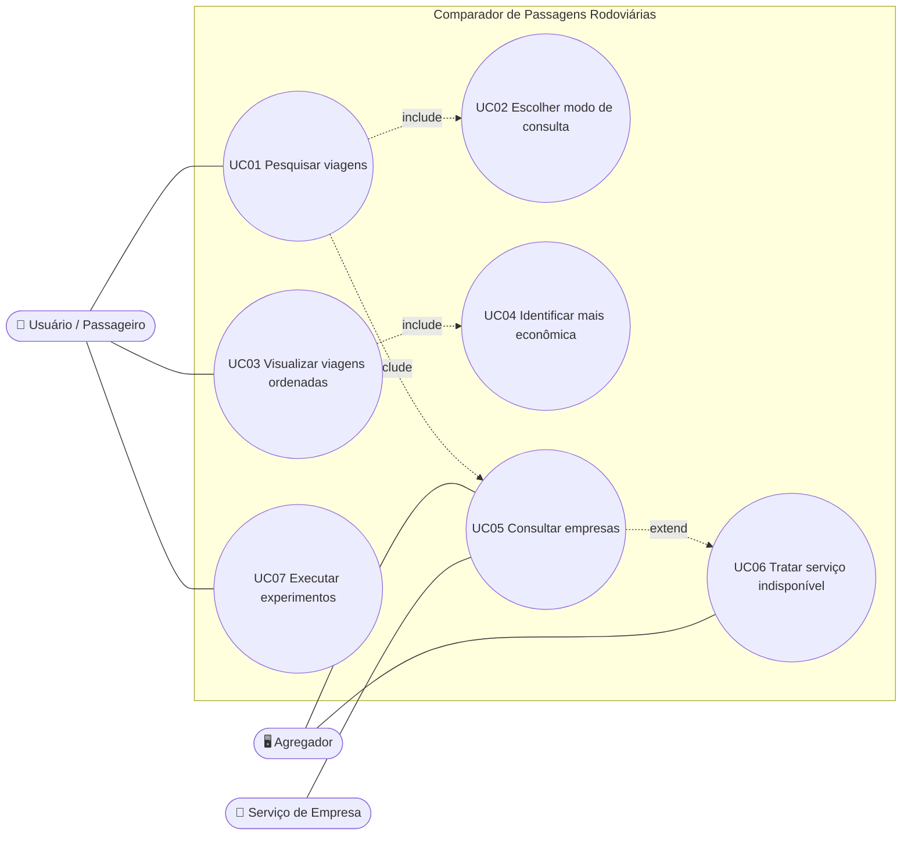

# Documento de Requisitos: Comparador de Passagens Rodoviárias

**Disciplina:** Sistemas Distribuídos (UNIFESSPA / FACSI)
**Tema:** 2, Comparador de Passagens Rodoviárias
**Versão:** 1.0

---

## 1. Descrição do problema

Quem precisa viajar de ônibus entre cidades do Pará (por exemplo, Marabá → Belém) tem que consultar o site ou o guichê de cada empresa separadamente para descobrir horários e preços. É um processo lento, e o passageiro corre o risco de não encontrar a opção mais barata.

Cada empresa mantém seu próprio sistema, independente dos demais. Uma plataforma que reúna essas informações precisa conversar com vários sistemas remotos. Se fizer isso um de cada vez, o tempo de resposta vira a soma dos tempos de todas as empresas. Além disso, a plataforma não pode parar de funcionar só porque o sistema de uma empresa está fora do ar ou lento.

## 2. Objetivo do sistema

Desenvolver uma aplicação distribuída cliente-servidor que:

- receba do passageiro a origem, o destino e a data da viagem;
- consulte ao mesmo tempo os sistemas de pelo menos quatro empresas de ônibus independentes, usando sockets TCP e threads;
- consolide as viagens encontradas, ordene por preço e destaque a mais econômica;
- meça e compare o desempenho das estratégias de consulta sequencial e concorrente.

## 3. Escopo

**Dentro do escopo**
- Consulta de viagens por origem, destino e data.
- 4 serviços de empresas (Viação Marabá, TransBrasil, Expresso Pará, Rodoviária Sul) com dados simulados em memória.
- Agregador com consulta sequencial e concorrente, timeout e tolerância a falhas.
- Cliente em terminal (sem interface gráfica).
- Experimentos automatizados de desempenho com geração de CSV.

**Fora do escopo**
- Compra, reserva ou pagamento de passagens.
- Banco de dados, cadastro de usuários e autenticação.
- Integração com sistemas reais de empresas de ônibus.
- Interface gráfica ou web.

## 4. Atores

| Ator | Tipo | Descrição |
|------|------|-----------|
| **Usuário / Passageiro** | Humano | Informa origem, destino, data e modo de consulta pelo cliente de terminal e analisa os resultados. |
| **Agregador** | Sistema | Recebe as consultas dos clientes, consulta os serviços das empresas, consolida e devolve os resultados. |
| **Serviço de Empresa** | Sistema (×4) | Representa o sistema de vendas de uma empresa de ônibus. Responde com as viagens disponíveis para a rota e a data. |

## 5. Casos de uso

| Caso de uso | Descrição resumida |
|-------------|--------------------|
| UC01 Pesquisar viagens | O passageiro informa origem, destino e data e envia a consulta. |
| UC02 Escolher modo | O passageiro escolhe entre consulta sequencial ou concorrente. |
| UC03 Visualizar viagens | O cliente exibe a tabela com empresa, saída, chegada, duração e preço, em ordem crescente de preço. |
| UC04 Identificar mais econômica | A viagem de menor preço é destacada com `<-- MAIS ECONÔMICA`. |
| UC05 Consultar empresas | O agregador consulta os 4 serviços via TCP. |
| UC06 Tratar indisponibilidade | Se um serviço estiver desligado ou não responder em 2 s, ele é ignorado e o usuário recebe um aviso. |
| UC07 Executar experimentos | O avaliador roda o script que compara os tempos dos dois modos e gera um CSV. |

## 6. Requisitos Funcionais

| ID | Requisito | Prioridade | Onde é atendido |
|----|-----------|------------|-----------------|
| **RF01** | O sistema deve permitir que o usuário informe origem, destino e data da viagem. | Alta | `cliente.py`: `ler_consulta()` |
| **RF02** | O sistema deve consultar pelo menos 4 serviços independentes (empresas de ônibus). | Alta | `agregador.py`: lista `SERVICOS`; 4 processos em `servicos/` |
| **RF03** | O sistema deve permitir consultas sequenciais aos serviços. | Alta | `agregador.py`: `consultar_sequencial()` |
| **RF04** | O sistema deve permitir consultas concorrentes aos serviços. | Alta | `agregador.py`: `consultar_concorrente()` |
| **RF05** | O sistema deve apresentar preços, horários de saída e chegada e duração das viagens. | Alta | `cliente.py`: `exibir_resultado()` |
| **RF06** | O sistema deve ordenar as viagens por preço crescente. | Alta | `agregador.py`: `consolidar()` |
| **RF07** | O sistema deve identificar a viagem mais econômica. | Alta | campo `mais_economica`; marcador no cliente |
| **RF08** | O sistema deve registrar o tempo de execução de cada consulta. | Alta | campo `tempo_total_ms`; log do agregador; CSV dos experimentos |
| **RF09** | O sistema deve continuar funcionando mesmo se um ou mais serviços caírem ou ficarem lentos. | Alta | timeout de 2 s e tratamento de exceções em `consultar_servico()` |
| **RF10** | O sistema deve permitir realizar nova consulta sem reiniciar o programa. | Média | menu em laço no `cliente.py` |

## 7. Requisitos Não Funcionais

| ID | Requisito | Categoria | Como é verificado |
|----|-----------|-----------|-------------------|
| **RNF01** | A comunicação entre cliente, agregador e serviços deve usar sockets TCP, com mensagens JSON em UTF-8 delimitadas por `\n`. | Interoperabilidade | Cada componente é um processo separado; não há `import` entre eles. |
| **RNF02** | A consulta concorrente deve usar threads (`threading.Thread`), uma por serviço, sincronizadas com `join()`. | Desempenho | Código de `consultar_concorrente()`. |
| **RNF03** | O agregador deve atender múltiplos clientes simultaneamente, um por thread. | Escalabilidade | Abrir 2 ou mais clientes ao mesmo tempo: as consultas não esperam umas pelas outras. |
| **RNF04** | O sistema deve tratar falhas de comunicação, JSON inválido, desconexões e aplicar timeout de 2 s por serviço, sem encerrar nenhum processo. | Confiabilidade | Desligar um serviço; enviar JSON inválido; fechar o cliente no meio da consulta. |
| **RNF05** | A aplicação deve permitir experimentos de desempenho automatizados (sequencial x concorrente, latência, múltiplos clientes e indisponibilidade), gerando resultados em CSV e gráficos. | Testabilidade | `experimentos/experimento.py --experimento todos` e `experimentos/gerar_graficos.py`. |
| **RNF06** | Com latência simulada, o modo concorrente deve ser mais rápido que o sequencial. | Desempenho | Com 0,8 s por serviço: ≈ 3,2 s (sequencial) contra ≈ 0,8 s (concorrente). |

## 8. Restrições

- **R01:** Implementação somente em Python 3, sem frameworks e sem bibliotecas externas. Módulos permitidos: `socket`, `threading`, `json`, `time`, `sys`, `csv`.
- **R02:** É proibido simular a comunicação por chamadas diretas de função ou `import` entre os componentes. Toda troca de dados passa por sockets TCP.
- **R03:** Cada componente roda como processo independente: 4 serviços, 1 agregador e 1 ou mais clientes.
- **R04:** Não há banco de dados. Os dados de viagens são simulados dentro de cada serviço.
- **R05:** Portas fixas: 5001, 5002, 5003 e 5004 (serviços) e 6000 (agregador).
- **R06:** O sistema deve executar no Windows e no Linux com `python nome_do_arquivo.py`.
- **R07:** Código, mensagens e documentação em português (pt-BR).

## 9. Critérios de aceitação

| # | Cenário | Resultado esperado | Requisitos |
|---|---------|--------------------|------------|
| CA01 | Com tudo no ar, consultar Marabá → Belém em 2026-11-20 no modo concorrente. | Tabela com viagens das 4 empresas, ordenada por preço, com a mais barata marcada; "Serviços que responderam: 4/4". | RF01, RF02, RF04-RF08 |
| CA02 | Mesma consulta no modo sequencial. | Mesmas viagens; tempo total ≈ soma das latências (≈ 3,2 s com 0,8 s cada). | RF03, RF08 |
| CA03 | Desligar o Serviço 2 e repetir a consulta. | O sistema responde normalmente com 3 empresas e exibe "Serviço 2 (TransBrasil) indisponível". Nenhum processo é encerrado. | RF09, RNF04 |
| CA04 | Configurar um serviço com latência de 5 s. | O agregador desiste dele após 2 s e informa "tempo limite de 2 s excedido". | RF09, RNF04 |
| CA05 | Dois ou mais clientes consultam ao mesmo tempo. | Todos recebem a resposta; consultas concorrentes simultâneas levam ≈ 0,8 s cada (não 1,6 s). | RNF03 |
| CA06 | Após uma consulta, escolher "[1] Nova consulta". | Uma nova consulta é feita sem reiniciar o cliente. | RF10 |
| CA07 | Enviar texto que não é JSON para um serviço ou para o agregador. | O processo responde `status: "erro"` com "JSON inválido" e continua funcionando. | RNF04 |
| CA08 | Rodar `experimento.py --latencia 0.8`. | É gerado `resultados.csv` com 10 linhas (5 por modo) e o resumo mostra o concorrente mais rápido. | RNF05, RNF06 |
| CA09 | Consultar uma rota não cadastrada (ex.: Santarém → Altamira). | Cada empresa retorna viagens genéricas para a rota pedida. | RF02, RF05 |
| CA10 | Rodar `experimento.py --experimento todos` e depois `gerar_graficos.py`. | São gerados os CSVs dos experimentos 1 a 5, os gráficos SVG em `experimentos/graficos/` e as tabelas em `experimentos/RESULTADOS.md`. | RNF05 |
