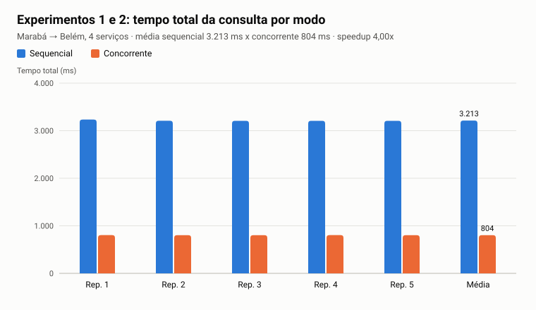
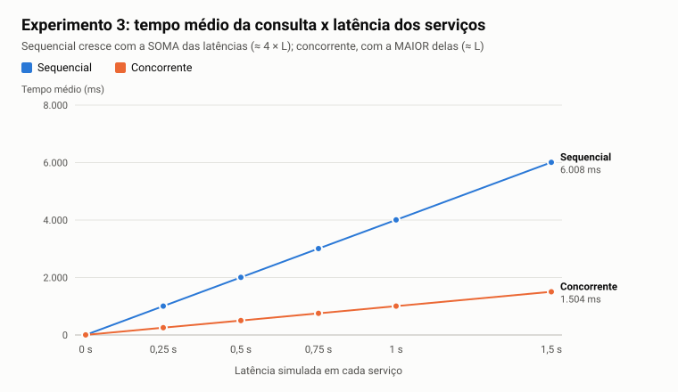
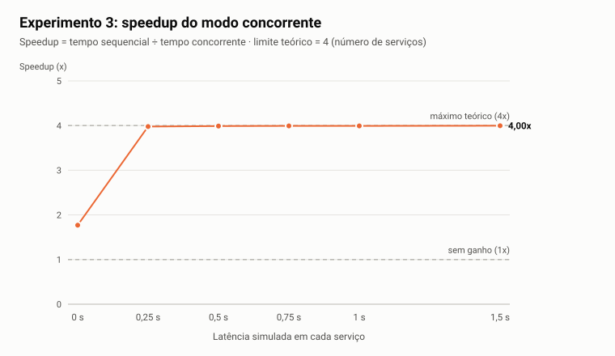
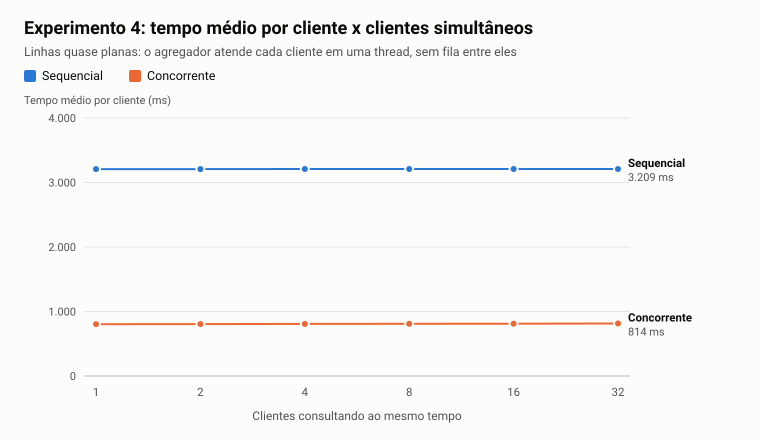
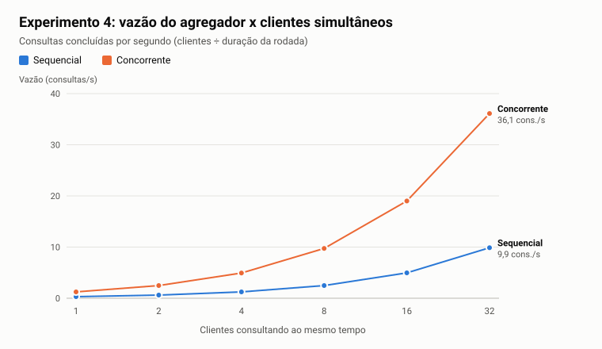
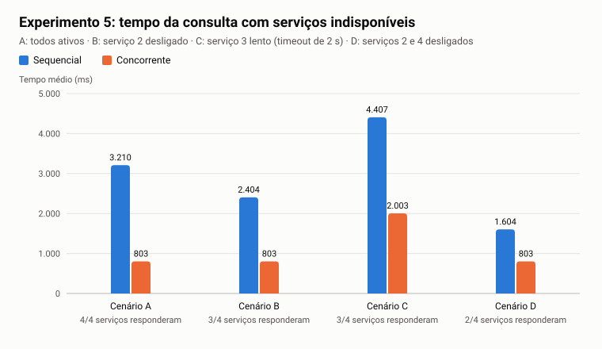

# Resultados dos experimentos

> Arquivo gerado automaticamente por `experimentos/gerar_graficos.py` em 13/11/2026 23:30.
> Ambiente: Python 3.14.4 em `linux`, todos os processos na mesma máquina (localhost).

Todos os tempos são o `tempo_total_ms` medido pelo agregador, do recebimento da consulta até a resposta consolidada.

## Experimentos 1 e 2: consulta sequencial x concorrente

Mesma consulta (Marabá → Belém, 2026-11-20) repetida 5 vezes em cada modo. Arquivo: `resultados.csv`.

| Repetição | Sequencial (ms) | Concorrente (ms) | Serviços (seq / conc) |
|---:|---:|---:|:---:|
| 1 | 3.234,0 | 804,1 | 4/4 · 4/4 |
| 2 | 3.208,5 | 803,5 | 4/4 · 4/4 |
| 3 | 3.207,7 | 803,6 | 4/4 · 4/4 |
| 4 | 3.208,0 | 803,8 | 4/4 · 4/4 |
| 5 | 3.207,8 | 803,3 | 4/4 · 4/4 |
| **Média** | **3.213,2** | **803,7** | |

- **Speedup** (sequencial ÷ concorrente): **4,00x**
- **Redução de tempo** no modo concorrente: **75,0%**

## Experimento 3: simulação de latência

A mesma consulta foi repetida para várias latências configuradas nos 4 serviços. Arquivo: `resultados_latencia.csv`.

| Latência por serviço | Sequencial (ms) | Concorrente (ms) | Speedup |
|---:|---:|---:|---:|
| 0 s | 4,5 | 2,5 | 1,77x |
| 0,25 s | 1.006,0 | 252,9 | 3,98x |
| 0,5 s | 2.006,0 | 503,0 | 3,99x |
| 0,75 s | 3.007,0 | 753,1 | 3,99x |
| 1 s | 4.006,5 | 1.003,6 | 3,99x |
| 1,5 s | 6.008,2 | 1.503,6 | 4,00x |

## Experimento 4: múltiplos clientes simultâneos

Em cada rodada, N clientes disparam a consulta no mesmo instante. Arquivo: `resultados_multiplos_clientes.csv`.

| Clientes | Modo | Tempo médio por cliente (ms) | Duração média da rodada (ms) | Vazão (consultas/s) | Falhas |
|---:|:---|---:|---:|---:|---:|
| 1 | Sequencial | 3.207,5 | 3.208,9 | 0,31 | 0/5 |
| 1 | Concorrente | 803,4 | 804,8 | 1,24 | 0/5 |
| 2 | Sequencial | 3.208,4 | 3.210,6 | 0,62 | 0/10 |
| 2 | Concorrente | 805,3 | 807,4 | 2,48 | 0/10 |
| 4 | Sequencial | 3.209,3 | 3.212,7 | 1,25 | 0/20 |
| 4 | Concorrente | 807,2 | 812,5 | 4,92 | 0/20 |
| 8 | Sequencial | 3.209,1 | 3.215,8 | 2,49 | 0/40 |
| 8 | Concorrente | 809,2 | 822,0 | 9,73 | 0/40 |
| 16 | Sequencial | 3.209,4 | 3.223,7 | 4,96 | 0/80 |
| 16 | Concorrente | 811,2 | 841,8 | 19,01 | 0/80 |
| 32 | Sequencial | 3.208,7 | 3.241,0 | 9,87 | 0/160 |
| 32 | Concorrente | 813,7 | 886,1 | 36,11 | 0/160 |

## Experimento 5: indisponibilidade de serviço

Os serviços "desligados" fecham a porta TCP de verdade durante o cenário (operação `simular_queda`), e o serviço "lento" demora 3 s, mais que o timeout de 2 s do agregador. Arquivo: `resultados_indisponibilidade.csv`.

| Cenário | Descrição | Sequencial (ms) | Concorrente (ms) | Serviços que responderam | Viagens |
|:---:|:---|---:|---:|:---:|---:|
| A | Todos os serviços ativos | 3.210,0 | 803,0 | 4/4 | 11 |
| B | Serviço 2 desligado | 2.404,5 | 802,9 | 3/4 | 8 |
| C | Serviço 3 lento (3 s > timeout) | 4.406,7 | 2.003,0 | 3/4 | 9 |
| D | Serviços 2 e 4 desligados | 1.603,6 | 802,7 | 2/4 | 5 |

Avisos devolvidos ao cliente:

- **A**: nenhum aviso
- **B**: `Serviço 2 (TransBrasil) indisponível: conexão recusada (serviço desligado)`
- **C**: `Serviço 3 (Expresso Pará) indisponível: tempo limite de 2 s excedido`
- **D**: `Serviço 2 (TransBrasil) indisponível: conexão recusada (serviço desligado)` / `Serviço 4 (Rodoviária Sul) indisponível: conexão recusada (serviço desligado)`

